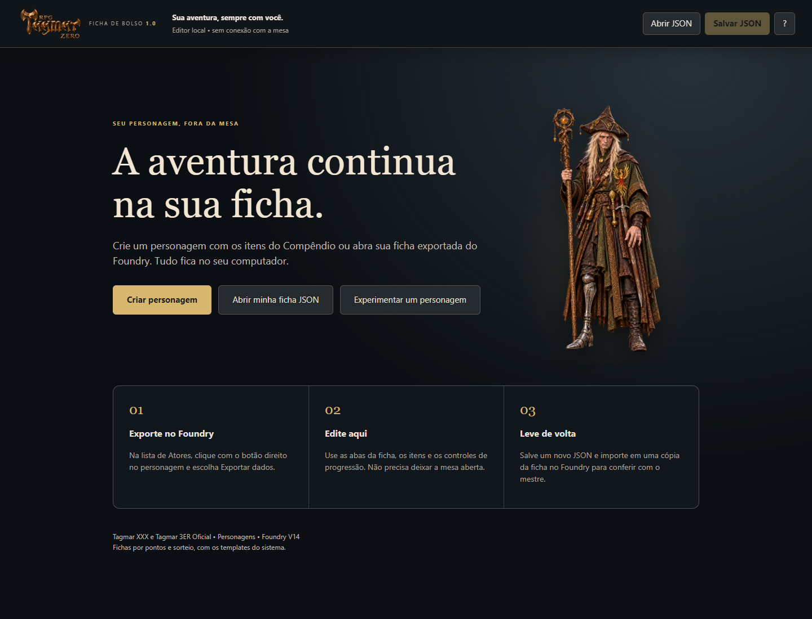

# Tagmar — Ficha de Bolso 1.0

Editor local para criar, consultar e editar personagens do Tagmar fora do Foundry. Comece no estágio 1 ou abra uma ficha exportada. Ao terminar, baixe o JSON para levar à mesa.

Abra o editor no navegador e monte ou consulte seu personagem mesmo com o Foundry do mestre fechado. O programa funciona offline e os arquivos ficam no seu computador.

**[Baixar somente o editor HTML](https://github.com/piratabarba-blip/tagmar-ficha-de-bolso/releases/download/v1.0.0/Ficha.de.Bolso.html)** · **[Baixar o pacote 1.0.0](https://github.com/piratabarba-blip/tagmar-ficha-de-bolso/releases/download/v1.0.0/tagmar-ficha-de-bolso-1.0.0.zip)** · [Versões e novidades](https://github.com/piratabarba-blip/tagmar-ficha-de-bolso/releases)



## Começar

1. Extraia o ZIP em uma pasta.
2. Abra **Ficha de Bolso.html** no Chrome ou Edge. Se o Windows abrir um editor de texto, use **Abrir com → navegador**.
3. Clique em **Criar personagem**, escolha o sistema e o modo da mesa. Use o Compêndio para adicionar a raça, a profissão e os demais itens.
4. Para editar uma ficha existente, clique em **Abrir minha ficha JSON** ou arraste o arquivo para a janela. **Experimentar um personagem** abre uma ficha fictícia.

O HTML contém tudo que precisa para funcionar. É possível copiar somente esse arquivo para outro computador. Os outros arquivos do pacote são documentação, exemplo, fontes e testes.

Se baixou somente o HTML, basta abri-lo no navegador. A página de código do GitHub não executa o editor: use um dos links de download acima.

## Levar a ficha do Foundry para o editor

Com a mesa aberta, exporte os dados do personagem em JSON pelo menu do ator. Guarde esse arquivo original. É necessário um ator do tipo **Personagem** dos sistemas Tagmar XXX ou Tagmar 3ER Oficial. NPCs, veículos, mundos e arquivos de compêndios não são aceitos nesta versão.

Depois da exportação, o jogador pode consultar e editar a ficha sem que o mestre mantenha o Foundry aberto.

Ao abrir um JSON, o editor pede o modo de cálculo da mesa. A escolha é necessária porque o arquivo pode vir sem essa configuração do Foundry. Use **Preservar valores** para manter os números exportados e fazer ajustes manuais.

## Cálculos e estágio

Você também pode trocar o modo no menu esquerdo.

- **Preservar valores:** edição manual, sem recalcular os totais.
- **Por pontos:** atributos e somas da ficha por pontos.
- **Por sorteio:** características sorteadas, modificadores raciais e ajustes da ficha por sorteio.

Em **Por pontos** e **Por sorteio**, a ficha recalcula os totais ao escolher o modo, ao sair de um campo alterado ou ao salvar um item. O indicador **Recálculo automático ativo** mostra quando essa opção está ligada. Passe o mouse sobre **?** para ver a ajuda do controle.

Os cálculos reaproveitam as funções do sistema Tagmar: atributos, habilidades, combate, técnicas, magia, carga, defesa, EF, EH, VB, Karma, resistências e pontos de aquisição. Parte deles depende dos itens de raça e profissão da ficha. Valores ausentes recebem padrões para a apresentação; abrir e exportar sem editar não acrescenta esses padrões ao arquivo.

Ao atingir o XP necessário, **Subir Nível** aparece junto aos Pontos de Experiência na aba **Básico**. O botão rola um d10 local, aplica a tabela de EH da profissão com o Físico e atualiza o estágio e a EH máxima. Em **Preservar valores**, escolha o modo de cálculo da mesa para fazer a rolagem. Depois, distribua os pontos nas habilidades, técnicas, grupos de armas e magias. A ficha sinaliza saldos negativos.

Use **+** e **−** na linha de uma habilidade, técnica de combate ou magia para ajustar um nível por vez. Em **Por pontos** e **Por sorteio**, o saldo é recalculado conforme o custo do item. Em **Preservar valores**, o saldo segue manual.

## Editar a biografia e os itens

- Na aba **Biografia**, clique em **Editar biografia**. O editor visual também aparece nas descrições e nos efeitos dos itens, com negrito, itálico e listas.
- Use o lápis ou o nome do item na ficha, ou abra **Todos os itens** para consultar por categoria e buscar por nome ou tipo.
- O editor apresenta os campos de jogo de cada tipo de item. No combate, os danos por percentual ficam em uma tabela, com o dano calculado para consulta. Os dados internos permanecem no JSON.
- No painel **Criar item**, clique no tipo desejado para abrir o formulário. Ao salvar, a ficha mostra a aba correspondente.
- Use **Importar item JSON** para adicionar um item Tagmar exportado do Foundry. Ele recebe um novo ID na ficha para evitar colisões.
- O menu **Dados avançados** permite editar o JSON completo, incluindo campos especiais não exibidos nas abas.
- Use **Desfazer** e **Refazer** para voltar até 30 operações.

O **Compêndio** da lateral inclui 2.369 entradas de **Criação de Fichas** e **Terras Selvagens**. Escolha a categoria, abra a coleção e navegue pelas pastas de origem. A busca percorre a pasta aberta e suas subpastas. Arraste um resultado para a ficha ou clique em **+** para adicionar uma cópia editável. Para substituir a raça ou a profissão, confirme a troca.

Em **03 - Habilidades**, use **Adicionar habilidades comuns** ou abra uma das seis pastas e escolha **Adicionar grupo**. A ficha mantém as habilidades que você já tem e adiciona somente as que faltam. Habilidades novas começam sem treino. A criação manual continua disponível.

O catálogo inclui textos e dados de jogo. Nas fichas do Tagmar XXX, os itens adicionados pelo compêndio levam no JSON os caminhos dos ícones do pacote quando disponíveis. Os ícones aparecem no Foundry com o XXX instalado. O editor offline e as cópias do Tagmar 3ER Oficial usam ícones genéricos para esses itens. A seleção foi feita a partir dos snapshots locais e exclui entradas marcadas como não oficiais. O conteúdo é do Projeto Tagmar, sob CC BY-NC-SA 3.0 BR. [Licenciamento do Projeto Tagmar](https://tagmar.com.br/Licenciamento.aspx)

## Salvar e devolver ao Foundry

1. Clique em **Salvar JSON**, ou pressione **Ctrl+S**.
2. Confira as diferenças em relação ao arquivo aberto. É possível baixar um relatório separado.
3. Clique em **Baixar JSON da ficha** e confira o arquivo na pasta Downloads.
4. Se começou do zero, crie um ator do tipo **Personagem** no sistema escolhido. Feche a ficha desse ator, clique com o botão direito no nome dele na lista de atores e escolha **Importar Dados**. Para uma ficha existente, faça esse teste em uma cópia.
5. Reabra a ficha e confira o nome, os atributos, os grupos de armas e os valores atuais de EF, EH e Karma antes de usá-la na mesa. Use no mundo o mesmo modo de atributos escolhido no editor.

O editor exporta o formato de ator, sem envolver a ficha em um formato próprio do aplicativo. IDs, itens, flags, efeitos e campos desconhecidos são preservados, salvo campos explicitamente alterados ou recalculados. O arquivo original no disco não é sobrescrito.

Se o mestre alterou o personagem depois da exportação, compare as duas versões antes de substituir: não existe sincronização ou união automática das alterações.

## Imprimir ou salvar em PDF

Abra a ficha e clique em **Imprimir ficha** no menu esquerdo. Escolha **Fundo branco** ou **Fundo escuro**. Na janela do navegador, escolha uma impressora ou **Salvar como PDF**. O layout em A4 organiza as seções na ordem do Foundry e acrescenta páginas conforme a quantidade de dados. O PDF guarda um retrato da ficha naquele momento. Para imprimir frente e verso, selecione essa opção na impressora.

## Rascunho e imagens

O editor tenta guardar um único rascunho no armazenamento local do navegador. Na próxima abertura, use **Recuperar rascunho**. Isso depende do navegador, do espaço disponível e do caminho do HTML; limpar os dados do navegador pode apagar o rascunho. **Salvar JSON** é a forma de guardar e transportar sua ficha.

Imagens que estão no servidor Foundry não são carregadas pela rede. O caminho original permanece no JSON. **Retrato local** permite selecionar uma imagem para visualizar nesta sessão, sem substituir o caminho usado na mesa.

## Escopo e compatibilidade

- A estrutura e o tema escuro reaproveitam as fichas do sistema; fontes, ícones e alguns diálogos são adaptados. Não reproduz todos os temas e módulos do Foundry.
- Active Effects do Foundry são preservados, mas não executados. Itens do tipo **Efeito** do próprio Tagmar participam dos cálculos.
- Não executa macros, rolagens da mesa, integrações com módulos, chat ou controles de combate. O d10 local de progressão não é registrado no chat.
- Os campos formatados mantêm o conteúdo original no JSON enquanto não forem editados. Ao salvar uma edição, o editor guarda a formatação de texto compatível e remove mídias, scripts e estilos externos do campo alterado.
- Dados de módulos podem causar recálculos adicionais quando a ficha voltar ao Foundry.
- Interface voltada a computador; em telas pequenas algumas tabelas precisam de rolagem horizontal.
- Limites: ficha de até 20 MB, até 5.000 itens e estágio de 1 a 100. Valores extremos de atributos não são aceitos nos cálculos automáticos.

## Validação da versão 1.0

Testes automatizados de cálculos, progressão, efeitos Tagmar, desfazer/refazer, validação de arquivos e preservação de metadados. Teste real no Chrome com o HTML aberto por `file://`, rede desativada, todas as abas, edição e criação de item, busca, mudança de apresentação, recuperação de rascunho, dois modos de ficha, download e reabertura de JSON. Verificação de conteúdo HTML malicioso sem execução e sem requisições de rede.

A reimportação de uma ficha criada no editor foi conferida em uma mesa do Tagmar XXX no Foundry 14.370, incluindo os itens e seus ícones. A impressão em A4 foi conferida nos dois temas, com tabelas que continuam nas páginas seguintes. Para personagens em uso, confira a importação em uma cópia.

## Código-fonte e reprodução

Base de desenvolvimento: Tagmar XXX `2.7.0-v14.1-rc.52`, para Foundry V14. As funções de cálculo e o esquema foram comparados com a cópia local do Tagmar 3ER Oficial e não apresentaram diferenças. Os hashes dos arquivos de origem estão em `vendor/provenance.json`.

- `src/`: modelo de dados, interface e estilos do editor.
- `vendor/`: templates, esquema, funções e estilos reaproveitados, biblioteca Handlebars e créditos.
- `tools/build.cjs`: produz o HTML autocontido.
- `tools/vendor.cjs`: atualiza os arquivos de origem mediante indicação explícita de uma pasta Tagmar e da biblioteca Handlebars.
- `tests/`: testes de modelo e de navegador; arquivos gerados ficam em `test-results/`.

Para desenvolver, use Node.js 22 ou superior, instale as dependências de desenvolvimento e execute:

```text
npm install
npm test
npm run build
npm run test:browser
```

O teste de navegador usa Chrome instalado. O script também aceita como argumento o caminho de um pacote Playwright já disponível; o build aceita o caminho de um pacote Handlebars. Para usar o editor pronto, nada disso é necessário.

## Créditos e licenciamento

Fichas e implementação Tagmar por **Marcos Walker e Vinicius Fernandez**. Adaptação portátil assistida por Codex.

Este trabalho utiliza e adapta materiais do **Projeto Tagmar**, disponíveis em [tagmar.com.br](https://www.tagmar.com.br/). O conteúdo derivado, incluindo nomes, regras e elementos das fichas, mantém a licença **Creative Commons Atribuição-NãoComercial-CompartilhaIgual 3.0 Brasil (CC BY-NC-SA 3.0 BR)**. Consulte o [licenciamento do Tagmar](https://tagmar.com.br/Licenciamento.aspx) e o [texto da licença](https://creativecommons.org/licenses/by-nc-sa/3.0/br/legalcode). As adaptações desta versão são a interface offline, a edição e exportação local e a execução dos cálculos fora do Foundry.

O código derivado permanece sob **GPL-3.0-or-later**, conforme a licença do projeto de origem. Handlebars e Bootstrap Grid mantêm suas licenças MIT. Veja `LICENSE.md` e os avisos em `vendor/`. Nenhum código proprietário do core do Foundry VTT está incluído. Este editor não é um produto do Foundry Gaming.
