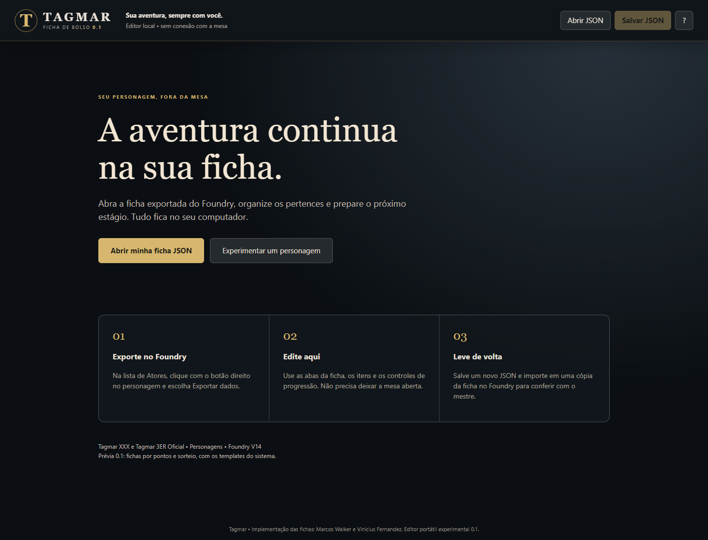

# Tagmar — Ficha de Bolso 0.1

Editor local para consultar e editar personagens do Tagmar fora do Foundry. Abra o JSON exportado da ficha, faça as alterações e baixe um novo JSON para levar de volta à mesa. O Foundry pode ficar fechado durante a edição.

Esta é a primeira versão para experimentar e ajustar com os jogadores. Não há instalação, conta, servidor ou conexão com a internet. O editor não envia a ficha a nenhum serviço.

**[Baixar o pacote 0.1.0](https://github.com/piratabarba-blip/tagmar-ficha-de-bolso/releases/download/v0.1.0/tagmar-ficha-de-bolso-0.1.0.zip)** · **[Baixar somente o editor HTML](https://github.com/piratabarba-blip/tagmar-ficha-de-bolso/releases/download/v0.1.0/Ficha.de.Bolso.html)** · [Versões e novidades](https://github.com/piratabarba-blip/tagmar-ficha-de-bolso/releases)



## Começar

1. Extraia o ZIP em uma pasta.
2. Abra **Ficha de Bolso.html** no Chrome ou Edge. Se o Windows abrir um editor de texto, use **Abrir com → navegador**.
3. Clique em **Experimentar um personagem** para conhecer as abas com uma ficha fictícia.
4. Para editar sua ficha, clique em **Abrir minha ficha JSON**, ou arraste o arquivo para a janela.

O HTML contém tudo que precisa para funcionar. É possível copiar somente esse arquivo para outro computador. Os outros arquivos do pacote são documentação, exemplo, fontes e testes.

Se baixou somente o HTML, basta abri-lo no navegador. A página de código do GitHub não executa o editor: use um dos links de download acima.

## Levar a ficha do Foundry para o editor

Com a mesa aberta, exporte os dados do personagem em JSON pelo menu do ator. Guarde esse arquivo original. É necessário um ator do tipo **Personagem** dos sistemas Tagmar XXX ou Tagmar 3ER Oficial. NPCs, veículos, mundos e arquivos de compêndios não são aceitos nesta versão.

Depois da exportação, o jogador pode consultar e editar a ficha sem que o mestre mantenha o Foundry aberto.

Ao abrir um JSON, o editor começa em **Preservar valores**. Isso mantém os números exportados e permite editar campos sem refazer as somas. O JSON não contém todas as configurações do mundo; por isso, o editor não escolhe automaticamente o modo de cálculos da mesa.

## Cálculos e estágio

No menu esquerdo, escolha o modo que a ficha já utiliza:

- **Preservar valores:** edição manual, sem recalcular os totais.
- **Por pontos:** atributos e somas da ficha por pontos.
- **Por sorteio:** características sorteadas, modificadores raciais e ajustes da ficha por sorteio.

Clique em **Recalcular ficha** para conferir os totais. Com um modo calculado ativo, as próximas edições também recalculam a ficha. Trocar o modo não converte automaticamente um personagem de pontos para sorteio: os dois modelos utilizam alguns campos de maneiras diferentes.

Os cálculos reaproveitam as funções do sistema Tagmar: atributos, habilidades, combate, técnicas, magia, carga, defesa, EF, EH, VB, Karma, resistências e pontos de aquisição. Parte deles depende dos itens de raça e profissão da ficha. Valores ausentes recebem padrões para a apresentação; abrir e exportar sem editar não acrescenta esses padrões ao arquivo.

**Avançar estágio** verifica a experiência, pede o resultado do d10 e aplica a tabela de EH da profissão com o Físico. Você pode informar o dado combinado com o mestre ou sortear um d10 local. Depois, distribua os pontos nas habilidades, técnicas, grupos de armas e magias. Saldos negativos são sinalizados; a versão 0.1 não impede todas as escolhas fora das regras da mesa.

## Editar os itens

- Use o lápis ou o nome do item na ficha, ou o botão **Todos os itens**.
- O editor de item mostra seus campos, inclusive dados específicos da raça e profissão.
- Use **Criar item** para preencher uma entrada manualmente.
- Use **Importar item JSON** para adicionar um item Tagmar exportado do Foundry. Ele recebe um novo ID na ficha para evitar colisões.
- O menu **Dados avançados** permite editar o JSON completo, incluindo campos especiais não exibidos nas abas.
- Use **Desfazer** e **Refazer** para voltar até 30 operações.

Esta versão não inclui uma cópia dos compêndios. Itens já presentes na ficha permanecem disponíveis offline.

## Salvar e devolver ao Foundry

1. Clique em **Salvar JSON**, ou pressione **Ctrl+S**.
2. Confira as diferenças em relação ao arquivo aberto. É possível baixar um relatório separado.
3. Clique em **Baixar JSON da ficha** e confira o arquivo na pasta Downloads.
4. Com a mesa aberta, importe o arquivo primeiro em uma **cópia do personagem** e compare os valores com o mestre.
5. Depois da conferência, utilize a ficha atualizada na mesa.

O editor exporta o formato de ator, sem envolver a ficha em um formato próprio do aplicativo. IDs, itens, flags, efeitos e campos desconhecidos são preservados, salvo campos explicitamente alterados ou recalculados. O arquivo original no disco não é sobrescrito.

Se o mestre alterou o personagem depois da exportação, compare as duas versões antes de substituir: não existe sincronização ou união automática das alterações.

## Rascunho e imagens

O editor tenta guardar um único rascunho no armazenamento local do navegador. Na próxima abertura, use **Recuperar rascunho**. Isso depende do navegador, do espaço disponível e do caminho do HTML; limpar os dados do navegador pode apagar o rascunho. **Salvar JSON** é a forma de guardar e transportar sua ficha.

Imagens que estão no servidor Foundry não são carregadas pela rede. O caminho original permanece no JSON. **Retrato local** permite selecionar uma imagem para visualizar nesta sessão, sem substituir o caminho usado na mesa.

## Limites desta primeira versão

- A estrutura e o tema escuro reaproveitam as fichas do sistema; fontes, ícones e alguns diálogos são adaptados. Não reproduz todos os temas e módulos do Foundry.
- Active Effects do Foundry são preservados, mas não executados. Itens do tipo **Efeito** do próprio Tagmar participam dos cálculos.
- Não executa macros, rolagens da mesa, integrações com módulos, chat ou controles de combate. O d10 local de progressão não é registrado no chat.
- Descrições HTML são exibidas com formatação limitada; scripts e conteúdo externo não são executados. O texto original continua no JSON se não for editado.
- Dados de módulos podem causar recálculos adicionais quando a ficha voltar ao Foundry.
- Interface voltada a computador; em telas pequenas algumas tabelas precisam de rolagem horizontal.
- Limites: ficha de até 20 MB, até 5.000 itens e estágio de 1 a 100. Valores extremos de atributos não são aceitos nos cálculos automáticos.

## Validação da 0.1

Testes automatizados de cálculos, progressão, efeitos Tagmar, desfazer/refazer, validação de arquivos e preservação de metadados. Teste real no Chrome com o HTML aberto por `file://`, rede desativada, todas as abas, edição e criação de item, busca, mudança de apresentação, recuperação de rascunho, dois modos de ficha, download e reabertura de JSON. Verificação de conteúdo HTML malicioso sem execução e sem requisições de rede.

**Ainda depende de teste na sua mesa:** reimportar em um ator dentro do Foundry e conferir as particularidades dos módulos e das fichas reais. Os testes desta entrega usaram personagens fictícios; não alteraram mundos nem sistemas instalados.

## Código-fonte e reprodução

Base de desenvolvimento: Tagmar XXX `2.7.0-v14.1-rc.52`, para Foundry V14. As funções de cálculo e o esquema foram comparados com a cópia local do Tagmar 3ER Oficial e não apresentaram diferenças. Os hashes dos arquivos de origem estão em `vendor/provenance.json`.

- `src/`: modelo de dados, interface e estilos do editor.
- `vendor/`: templates, esquema, funções e estilos reaproveitados, biblioteca Handlebars e créditos.
- `tools/build.cjs`: produz o HTML autocontido.
- `tools/vendor.cjs`: atualiza os arquivos de origem mediante indicação explícita de uma pasta Tagmar e da biblioteca Handlebars.
- `tests/`: testes de modelo e de navegador; arquivos gerados ficam em `test-results/`.

Para desenvolver, use Node.js 22 ou superior, instale as dependências de desenvolvimento e execute:

```text
npm install
npm test
npm run build
npm run test:browser
```

O teste de navegador usa Chrome instalado. O script também aceita como argumento o caminho de um pacote Playwright já disponível; o build aceita o caminho de um pacote Handlebars. Para usar o editor pronto, nada disso é necessário.

## Créditos e licenciamento

Fichas e implementação Tagmar: **Marcos Walker e Vinicius Fernandez**. Adaptação portátil 0.1 assistida por Codex.

Este trabalho utiliza e adapta materiais do **Projeto Tagmar**, disponíveis em [tagmar.com.br](https://www.tagmar.com.br/). O conteúdo derivado, incluindo nomes, regras e elementos das fichas, mantém a licença **Creative Commons Atribuição-NãoComercial-CompartilhaIgual 3.0 Brasil (CC BY-NC-SA 3.0 BR)**. Consulte o [licenciamento do Tagmar](https://tagmar.com.br/Licenciamento.aspx) e o [texto da licença](https://creativecommons.org/licenses/by-nc-sa/3.0/br/legalcode). As adaptações desta versão são a interface offline, a edição e exportação local e a execução dos cálculos fora do Foundry.

O código derivado permanece sob **GPL-3.0-or-later**, conforme a licença do projeto de origem. Handlebars e Bootstrap Grid mantêm suas licenças MIT. Veja `LICENSE.md` e os avisos em `vendor/`. Nenhum código proprietário do core do Foundry VTT está incluído. Este editor não é um produto do Foundry Gaming.
